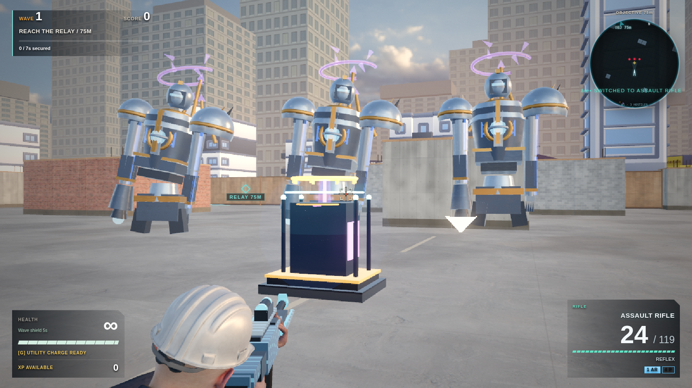
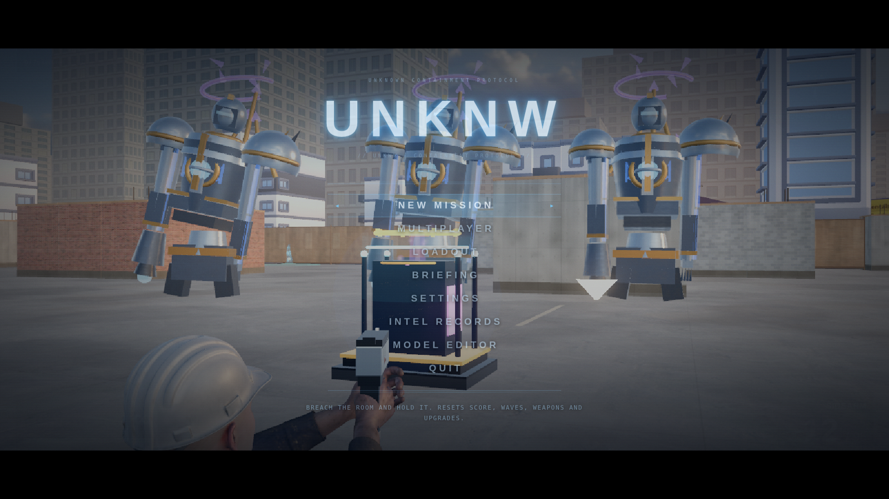
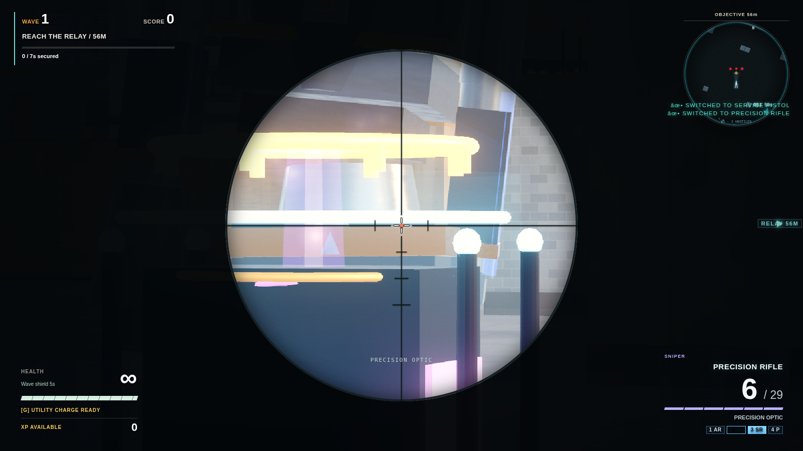
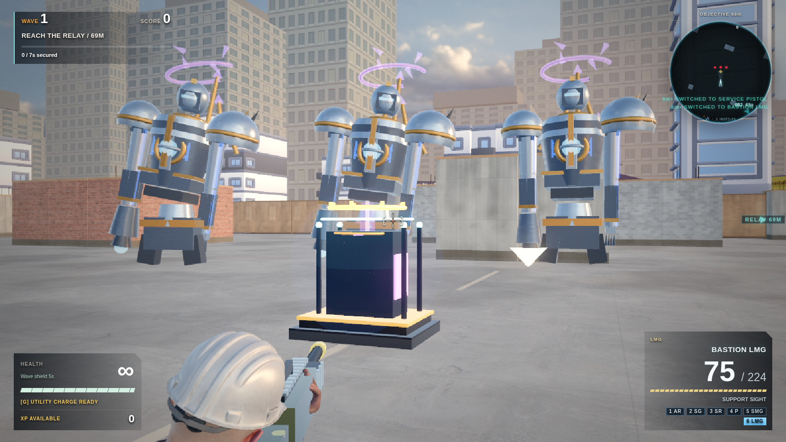
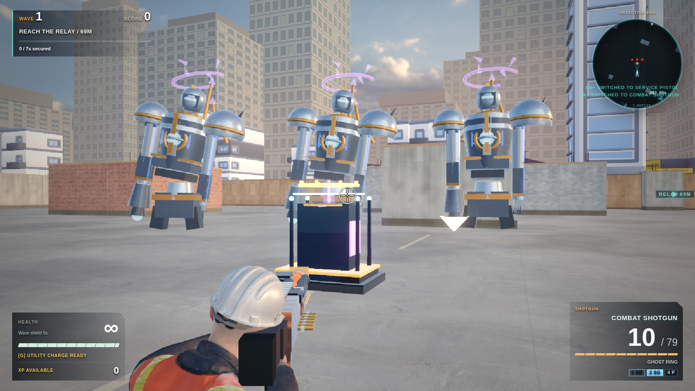

# UNKNW — Containment Protocol

A third-person survival shooter you can play in a browser. Hold a relay in an abandoned city district, fight off drones and the returning dead, and spend your kill XP on weapons and upgrades. Every tenth wave cuts the power and changes the fight.

**[Play UNKNW](https://lagilava.github.io/unknw-fps/)** · **[Report a bug](https://github.com/Lagilava/unknw-fps/issues)**



## Playing with friends

Open the play link on a desktop with a keyboard and mouse. Chrome or Edge is a good starting point. No installation is needed.

- **Solo:** choose **New Mission**, then click the screen to capture the mouse.
- **Co-op:** choose **Multiplayer → Host Game**, send your room code to your friend, and wait for them to join before launching.
- **Joining:** open the same play link, choose **Multiplayer → Join Game**, and enter the host's code.
- **PvP:** change the multiplayer mode before hosting.

Multiplayer uses PeerJS/WebRTC. The host must keep their tab open. Room creation alone does not guarantee that two different networks can connect: restrictive NATs may need a TURN relay.

The first load downloads large model, texture and audio files and compiles shaders. Give the loading screen time to finish. If play feels slow, try **Settings → Performance Mode** or accept the session's **Disable shadows** prompt.

## The objective

Start with a Service Pistol. Reach the marked relay and hold it for **7 uncontested seconds**. Nearby living enemies interrupt the upload; the HUD shows the objective distance, progress and contested state. Keep moving, clear space, and return to the relay.

Kills earn XP. Use it at the mystery box for new weapons, the Pack-a-Punch station for weapon upgrades, and the plaza statue for perks. Other weapons are locked until acquired; the loadout screen shows their profiles.

Blackout waves arrive every tenth wave. The normal HUD fails and the event replaces your gun with an incinerator. It has no magazine and does not reload.

## Controls

| Input | Action |
|---|---|
| WASD | Move |
| Mouse | Look |
| Left mouse button | Fire |
| Right mouse button (hold) | Aim |
| Shift (hold) | Sprint; aiming takes priority |
| Space | Jump |
| R | Reload |
| V | Melee |
| G | Throw a grenade |
| E | Use a nearby station or interactable |
| Mouse wheel / 1–9 | Select an owned weapon |
| F | Flashlight |
| I | Inspect weapon |
| C (hold) | Look back |
| Esc | Pause / release the cursor |
| F9 | Performance overlay |

## Weapons and handling

| Key | Weapon | Reload | Sight |
|---|---|---|---|
| 1 | Assault Rifle | Magazine | Reflex |
| 2 | Combat Shotgun | Shell inserts | Ghost ring |
| 3 | Precision Rifle | Top load | Precision scope |
| 4 | Service Pistol | Magazine | Iron sights |
| 5 | Hornet SMG | Magazine | Compact reflex |
| 6 | Bastion LMG | Drum | Support sight |
| 7 | Verdict DMR | Magazine | Marksman optic |
| 8 | Gemini Machine Pistol | Magazine | Focused-fire brackets |
| 9 | Mauler Auto-Shotgun | Drum | Wide aperture |

Aiming stays in the shoulder view; the Precision Rifle adds a scope overlay. Zoom adjusts mouse and touch sensitivity, and the shot direction follows the recoil reticle at the current field of view.

Reloads share one gameplay clock for ammo, HUD progress and the character animation. Ammo transfers at completion. Switching cancels an unfinished reload and clears its magazine/round props. Weapon upgrades shorten the next reload. The shotgun shows individual rounds rather than a detached tube magazine; weapons select their own reload sound.

The Precision Rifle, LMG and DMR use shorter body-relative fits. Long-gun stocks receive a chest-clearance correction with the hands fitted back onto their grips.

### Current weapon views

| Service Pistol | Precision Rifle |
|---|---|
|  |  |
| **Bastion LMG** | **Combat Shotgun** |
|  |  |

These views are captured by the browser regression test with shadows disabled. They show the running game, not concept art.

## Enemies and progression

- **Siege Drones:** telegraphed artillery attacks and area pressure.
- **Blink Seraphs:** reposition around your flank.
- **Null Cherubs:** deny safe ground and suppress sprint/reload with their Null Field.
- **Cloned Ghosts:** armed operators that strafe and return fire.
- **Zombies:** close-range pressure from the horde.

Pack-a-Punch has seven tiers. Perks improve damage, health, shields, movement and recovery. Parked-car alarms can distract enemies. A failed run can be restarted from the result screen.

## Local development

Use Node.js **22.19+** and npm.

```sh
npm ci
npm run dev
```

Open **http://localhost:3000/**. Vite uses `src/index.html` as its entry point.

```sh
npm run build       # static output in dist/
npm run typecheck   # TypeScript checks
```

The game loads runtime assets from `../assets/`. Production hosting must retain the directory layout used by the Pages workflow:

```text
index.html          redirects to play/
play/               compiled game, bundle/, classic world scripts
assets/             models, textures and audio
```

Pushing to `main` builds and deploys through [deploy-pages.yml](.github/workflows/deploy-pages.yml).

For local internet multiplayer, `Start Internet Multiplayer.bat` starts the local server and a Cloudflare tunnel. Install `cloudflared` first. See `turn-config.example.txt` for relay configuration; keep credentials out of Git.

## Tests and play-test feedback

Run the fast weapon-handling checks:

```sh
node --experimental-strip-types --test tests/weapon-handling.test.mjs
```

Run the all-weapon browser check; its configuration starts Vite:

```sh
npx playwright install chromium
npx playwright test --config .github/weapon-handling.config.cjs
```

The handling checks cover ammo conservation, partial reserves, cancellation, upgraded reload durations, reticle projection and frame-rate-independent aim blending. The browser check exercises reload completion, switching, aiming and body-fit diagnostics for every weapon, and captures the images above.

The wider Playwright suite lives in `src/tests/`. Many existing specs use the legacy entry point and their own test-server configuration; they are separate from the Vite handling check.

When reporting a play-test issue, include:

- Browser, device/GPU and whether Performance Mode was enabled.
- Weapon, wave and solo/co-op/PvP mode.
- Steps to reproduce, plus a screenshot or short clip.
- FPS from F9 if the issue involves stutter or slow rendering.

Automated checks do not replace testing on real GPUs or between friends on different networks.

## Source layout

| Location | Responsibility |
|---|---|
| `src/three_fps_game.ts` | Game loop, combat, character posing and integration |
| `src/modules/gun_config.ts` | Weapon roster and stats |
| `src/modules/weapon_handling.ts` | Reload state and aiming math |
| `src/modules/weapon_ads.ts` | Aim profiles and sight overlays |
| `src/modules/weapon_hand_fit.ts` | Grip fitting, scale and torso clearance |
| `src/modules/weapon_hud.ts` | Equipped weapon readout |
| `src/environment.js`, `src/exterior_map.js` | World construction |
| `src/modules/netcode.ts` | Peer-to-peer multiplayer |
| `assets/` | Runtime models, textures and audio |

Built with Three.js r166, TypeScript, Rapier physics, Howler and PeerJS. The world builders remain classic scripts so both entry points can load them.

The renderer keeps pooled lights allocated and changes their intensity rather than their visibility. Changing the light count can invalidate the material shader cache. Boot readiness is exposed as `body[data-rb-ready="1"]`; tests wait for it rather than guessing a loading delay.

## Asset credits

- HDRI skies — [Poly Haven](https://polyhaven.com), CC0.
- City kit buildings and props — [Kenney](https://kenney.nl), CC0.
- Landmark models — [Khronos glTF Sample Assets](https://github.com/KhronosGroup/glTF-Sample-Assets), CC0.
- Character models and animations — [Mixamo](https://www.mixamo.com), Adobe Mixamo license.
- SFX — [Kenney](https://kenney.nl) audio packs, CC0.
